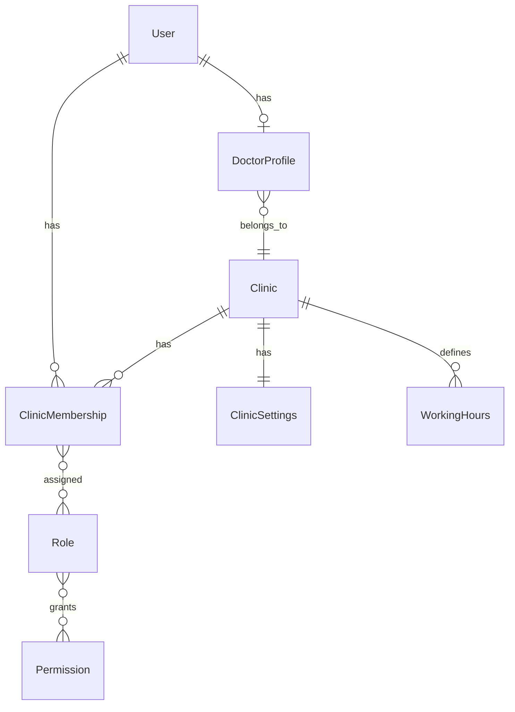
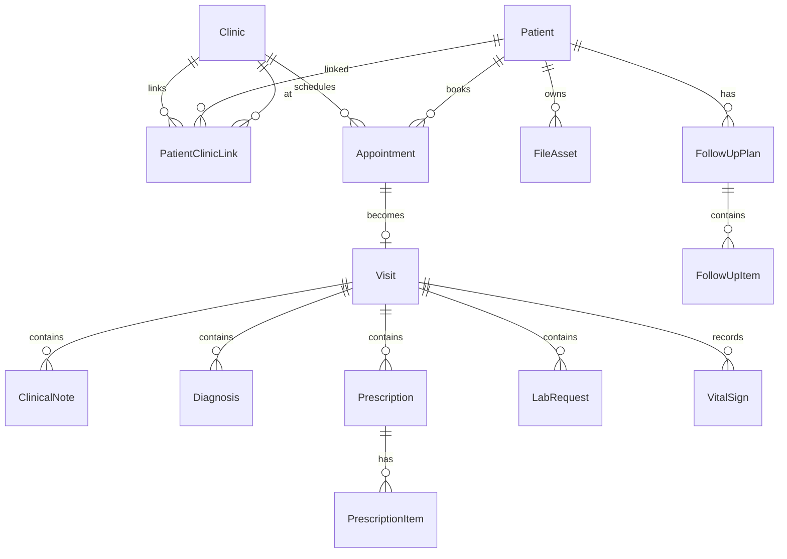
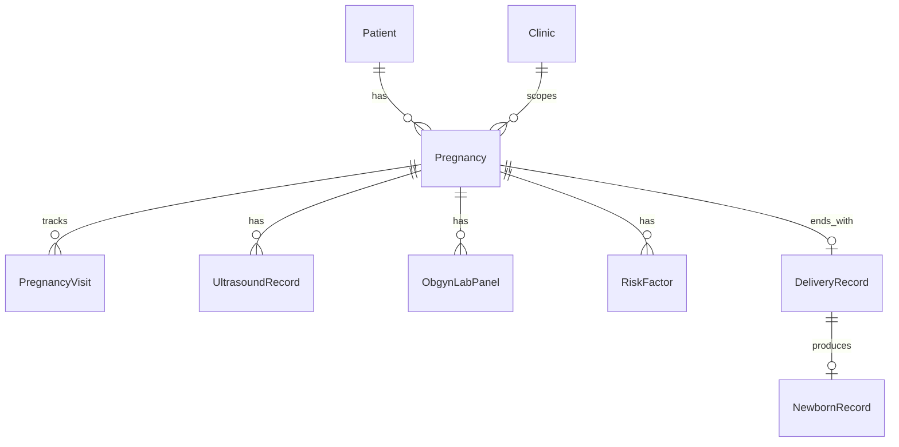
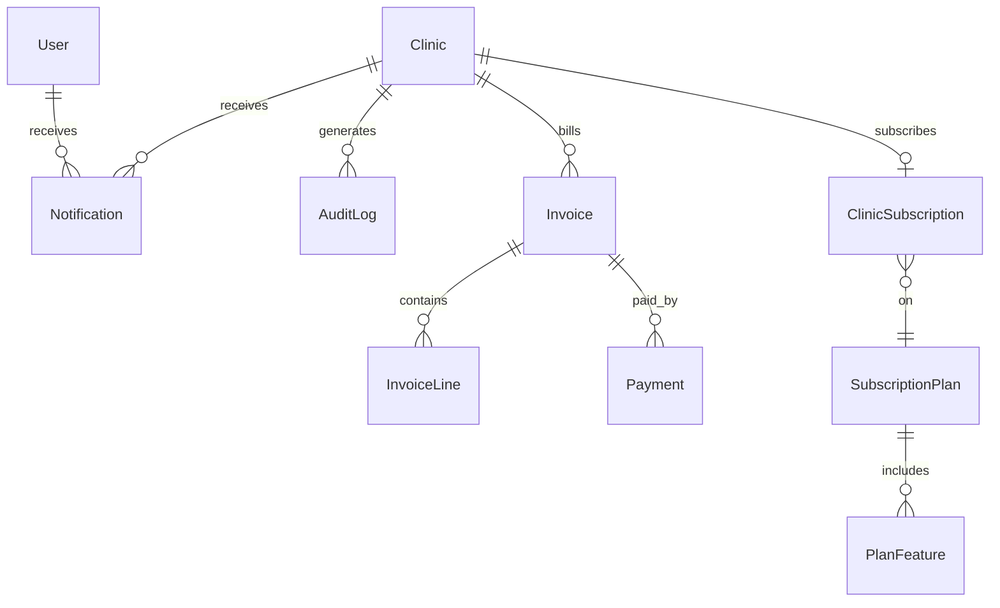

# Medicaloop Logical ERD

## Core Identity & Tenancy

## Clinical Core

## OBGYN Extension

## Platform Services

## Key Indexes (Planned)

| Table | Index | Purpose |
|-------|-------|---------|
| Appointment | `(clinic_id, scheduled_start)` | Calendar queries |
| Appointment | `(clinic_id, doctor_id, scheduled_start)` UNIQUE partial | Double-book prevention |
| PatientClinicLink | `(clinic_id, patient_id)` UNIQUE | Patient lookup |
| Clinic | `(slug)` UNIQUE | Public page routing |
| AuditLog | `(clinic_id, created_at)` | Audit queries |
| Notification | `(user_id, read_at, created_at)` | Unread notifications |

## Tenant Isolation Rule

Every table in the Clinical Core and OBGYN Extension groups includes `clinic_id` as a NOT NULL foreign key with an index.
